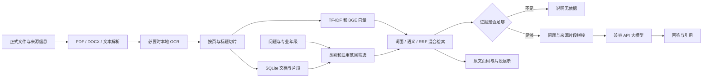

# 毕业设计技术方案 v0.3

课题：基于大模型 RAG 的校园知识问答系统设计与实现。更新：2026-10-13。

## 范围与目标

面向中国传媒大学通用教学办事资料与 2023 级计算机科学与技术专业文件，完成资料导入、解析切片、语义向量化、检索、证据生成、原文溯源与对照评价。五份官网公开文件及两份用户提供并确认的专业文件已入库。

核心工作是构建有来源与适用范围的知识库，比较检索方案，验证回答是否受证据支持。无需训练大模型、购买 GPU 或建立全校业务系统。最终交付要求以学院和导师通知为准。

## 架构

未配置生成模型时，证据以摘录展示；当前默认开启 DeepSeek 生成。兼容 API 的真实连接、简短生成及一条公开资料的完整 RAG 已通过。

## 技术选择与实现

| 模块 | 当前选择 | 原因与边界 |
|---|---|---|
| 服务与页面 | Python 3.12、FastAPI、原生 HTML/CSS/JS | 安装启动简单，接口与业务分离 |
| 文字解析 | pypdf、python-docx | PDF 文件页序号；Word 段落表格顺序 |
| 扫描识别 | RapidOCR、ONNX Runtime、PyMuPDF | CPU 本地处理；数字、复杂布局需核对 |
| 切片 | 400 字符、60 字符重叠，不跨 PDF 页/标题 | 当前最长片段 376 token，模型上限 512 |
| 文档库 | SQLite 文档、片段、元数据 | 下载、删除、哈希去重、备份 |
| 词面基线 | TF-IDF 中文字符 2–3 元组，最多 30,000 特征 | 适合名称、数字、专有词 |
| 语义向量 | BAAI/bge-small-zh-v1.5，CPU，512 维 | 已实际下载运行；记录查询前缀与 revision |
| 混合排序 | 语义与 TF-IDF 候选并集，RRF 常数 60 | 融合排名，避免分数尺度差异 |
| 生成 | 兼容 Chat Completions，温度 0.1 | 仅依据证据并引用 |
| 溯源 | 片段、文件、来源网址、PDF 页序号 | 编号检查不能替代结论支持判断 |

向量直接做余弦检索，NumPy/SciPy 保存可重建索引，未引入专门向量数据库。文档变更和模型更换会重建索引，适合小型毕业设计库。语义模型不执行远程自定义代码。

默认按 2023 年入学、计算机科学与技术筛选；明确问其他年级时按问题年级处理。仅参考文件和排除的示例不参与检索。字段无法判断所有过渡条款，需核对原文。

## 数据与异常处理

元信息包括名称、分类、版本、来源、SHA-256、专业、年级、发布日期、审核说明、参考标记和提取方式。原件另记录获取日期与来源页面，避免只保留加工文本。

单文件 10 MB、50 万提取字符、300 PDF 页、20 个扫描页。空文件、非法格式、重复文件、模型路径错误、接口超时与授权错误均有提示。索引与配置用本机锁保持一致。

专业毕业学分问题路由至培养方案，具体课程考核问题路由至课程大纲；“每门课程成绩比例由谁确定”等通用制度路由至办事流程。应用与实验共用路由。缺少证据就说明无依据。阈值与词面覆盖率减少无关匹配，它们不是正确率，无法保证所有无关问题均拒答。

密钥可仅在进程使用或用 Windows DPAPI 加密保存；读取配置不回显，不明文落盘，备份不保存。服务仅监听本机，无多人身份与文档权限；公开部署时需补账号、权限、限流与后台索引。

## 已完成与待完成

已完成：五份公开文件与两份专业文件入库、中文语义模型运行、OCR测试、三种检索、专业年级筛选、原文溯源、DeepSeek接入、开发检索实验、四组生成开发记录与备份。22项功能测试通过。

待完成：真实回答人工评分、独立测试集与正式论文分析。在线开发对照已执行，75次请求/76条结果；问题与限制见docs/开发对照结果.md。文件、账号和开发题核对无需重复。

## 实验设计

19 题开发集已由用户审核，4 道无依据题按用户要求删除。每题记录文件、页码、证据与版本，脚本检查证据到片段的映射。该集已用于规则开发，不能作为独立测试集。

正式目标可先定 50–100 题，依导师要求与标注负担调整。覆盖事实、流程、同义、课程、跨片段、版本、无依据问题。划分验证/测试，验证集调参，冻结后在独立测试上报告结论。

固定文档集、模型、温度和问题集，四组共享学校、年级、专业背景；三个 RAG 组共享证据提示词，直接回答组使用无文档提示，并记录这一差异。2026-10-13开发批次直接组遗漏学校背景，后续脚本已修正，但没有追溯改写或重跑该批结果：

1. 同模型直接回答，无检索上下文。
2. TF-IDF 检索 + 同模型。
3. BGE 语义检索 + 同模型。
4. RRF 混合检索 + 同模型。

指标：片段 Recall@K（检出的已标注相关片段占比）、MRR（首个正确片段排名倒数）、无依据拒答率、可回答问题误拒答率、检索 P95。标签不完备影响 Recall，需记录标注方式。

生成评价：人工正确性 0–2 分、条件遗漏、版本错误、证据支持、引用正确、无依据拒答、总耗时和生成耗时。编号有效不能直接计为引用正确。模板在 `evaluation/人工评分模板.md`。

脚本保存文档和题集哈希、模型 revision、参数、时间及逐题结果。在线模型版本按可获得信息记录，远程变化限制严格复现。模拟响应、虚构示例、开发题结果不得当正式生成性能。

## 论文与答辩

1. 绪论：校园信息查询问题、意义、本文工作。
2. 相关技术：大模型、RAG、Embedding、切片、检索、排名融合。
3. 需求与设计：场景、范围、功能、架构、数据模型、技术选择。
4. 实现：处理、索引、筛选、问答、来源、页面、异常。
5. 测试与实验：环境、语料、标注、对照、指标、结果、失败案例。
6. 总结：完成内容、边界、改进。

保留实际截图、切片例子、正确问答、同义问法、拒答、失败分析。结论以冻结后的真实结果为依据。文献见 `docs/文献阅读清单.md`。
